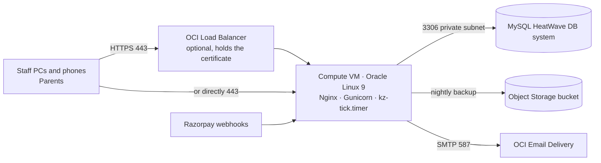

# Deploying on Oracle Cloud (OCI)

Target: one OCI Compute instance (Oracle Linux 9) running Nginx + Gunicorn + the scheduler timer, and the database on
**OCI MySQL HeatWave** (recommended) or MySQL on the same instance. Everything is installed by `deploy/oci/install.sh`.



## 1. Create the cloud resources (OCI console)

| Resource | Setting |
|---|---|
| VCN | public subnet (VM) + private subnet (database) |
| Security list / NSG | ingress 80, 443 from 0.0.0.0/0 to the VM; 22 from your office IP only; 3306 from the VM subnet to the DB subnet |
| Compute | Oracle Linux 9; VM.Standard.E4.Flex or A1.Flex, 2 OCPU / 16 GB is enough for 10 counters; boot volume 100 GB |
| MySQL HeatWave | MySQL 8.x, private subnet, high availability for production; enable automatic backups + point-in-time recovery |
| Object Storage | bucket `kz-backups` with a 90-day retention rule; a dynamic group for the VM with policy `allow dynamic-group kz-vm to manage objects in compartment <c> where target.bucket.name='kz-backups'` |
| Email Delivery | approved sender (e.g. no-reply@yourdomain), SMTP credentials |
| DNS | `A` record `ops.yourdomain.in` → VM public IP (or the load balancer) |

## 2. Database

From any machine that reaches the DB (the VM after step 3 has the `mysql` client):

```bash
sed -e 's/CHANGE_ME_OWNER_PASSWORD/<strong-1>/' -e 's/CHANGE_ME_APP_PASSWORD/<strong-2>/' deploy/oci/mysql-setup.sql \
  | mysql -h <db-private-ip> -u admin -p
```
HeatWave: create a **custom configuration** with `log_bin_trust_function_creators = ON` and apply it to the DB system (the
audit-trail triggers in migration 0002 need it). Time zone of the DB system can stay UTC — the app sets each connection's
time zone itself.

## 3. Install

```bash
scp Kiswa-Zaibus-App-2.8.0.zip opc@<vm-ip>:~ && ssh opc@<vm-ip>
sudo timedatectl set-timezone Asia/Kolkata
sudo dnf -y install unzip && unzip Kiswa-Zaibus-App-2.8.0.zip && cd Kiswa-Zaibus-App-2.8.0
sudo bash deploy/oci/install.sh --domain ops.yourdomain.in --email it@yourdomain.in
#   first run creates /etc/kz/kz.env and stops: edit it
sudo vi /etc/kz/kz.env      # DB_HOST, DB_PASSWORD, MIGRATE_DB_PASSWORD, SMTP_*, SMS_*, RAZORPAY_* (or leave empty = test mode)
sudo bash deploy/oci/install.sh --domain ops.yourdomain.in --email it@yourdomain.in --seed
```
`--seed` (first install only) loads companies, locations, roles, users, items and opening stock from
`backend/seed/seed_data.json` and prints **one temporary password** for all seeded users; each user changes it at first
sign-in (OTP to their mobile). Add `--demo-students` only on a test server. Add `--local-mysql` to install MySQL on the VM
instead of HeatWave.

What the installer does (re-runnable; finished steps are skipped):

| Step | Detail |
|---|---|
| packages | python3.12, nginx, nodejs 20 (build only), mysql client, firewalld, certbot |
| user + folders | system user `kz`; `/opt/kz-app` (code, root:kz), `/var/lib/kz/evidence` (uploads), `/var/log/kz`, `/etc/kz/kz.env` (640 root:kz) |
| Python | venv `/opt/kz-app/backend/.venv`, `requirements.txt` |
| PWA | `npm ci && npm run build` → `/opt/kz-app/frontend/dist` (node_modules removed afterwards) |
| database | `alembic upgrade head` with the schema-owner account |
| services | `kz-api.service` (Gunicorn on 127.0.0.1:5000), `kz-tick.timer` (every minute), `kz-backup.timer` (01:17) |
| web | `/etc/nginx/conf.d/kz.conf` (+ `kz_proxy.conf`, `kz_headers.conf`): serves the PWA, proxies `/api` and `/webhooks`, security headers, rate limits on sign-in |
| SELinux | `httpd_can_network_connect`, `httpd_sys_content_t` on `dist` |
| firewall | http + https open in firewalld |
| TLS | certbot `--nginx --redirect` (or terminate TLS on the OCI Load Balancer instead) |
| check | `deploy/oci/healthcheck.sh` must say *healthy* |

## 4. After install

1. Open `https://ops.yourdomain.in`, sign in as the Super Admin (temporary password + OTP), change the password.
2. **Setup** → check companies (GSTIN, address on bills), locations, counters, receipt & printer, roles.
3. **Settings → ERP import**: upload the student CSV from the MSEA ERP (trial run first).
4. **Razorpay** (per company): in the Razorpay dashboard create a webhook `https://ops.yourdomain.in/webhooks/razorpay/KG`
   (and `/ZE`) with events `payment.captured`, `payment.failed`, `refund.processed`, `settlement.processed`,
   `payment_link.paid`, the same secret as `RAZORPAY_WEBHOOK_SECRET_<CO>`. Restart `kz-api`, then Settings → Payments →
   *Request switch to Live* (Super Admin approves).
5. Backups: create `/etc/kz/backup.env` with `OCI_BUCKET=kz-backups` and `OCI_NAMESPACE=<ns>`; install the OCI CLI
   (`sudo dnf -y install python39-oci-cli`); test with `sudo systemctl start kz-backup && journalctl -u kz-backup -n 20`.
6. Finance & tax: **Finance & tax → Setup** — check the GST registrations (turn e-invoicing on where it applies), bank accounts,
   TDS sections, party PAN / section and employees; close the books to the last audited date. The Node.js document service
   `kz-docs` is installed and started by `install.sh` (`systemctl status kz-docs`); `DOCS_SECRET` is generated in `/etc/kz/kz.env`.
7. Phones: open the address in Chrome → menu → **Install app** (Android) / Share → Add to Home Screen (iPhone). Parents use
   `https://ops.yourdomain.in/shop`.

## 5. Updating to a new release

```bash
unzip Kiswa-Zaibus-App-2.x.y.zip && cd Kiswa-Zaibus-App-2.x.y && sudo bash deploy/oci/update.sh
```
`update.sh` dumps the database to `/var/lib/kz/pre-update-*.sql.gz`, keeps the previous code in `/opt/kz-app.prev`,
installs dependencies, rebuilds the PWA and the Node.js document service (`docs-service/`), runs migrations, restarts
`kz-docs` and `kz-api` and health-checks. On failure it puts the previous
code back (a migration that already ran is undone by restoring the dump — see MIGRATIONS.md).

## 6. Operations cheat-sheet

| Task | Command |
|---|---|
| status | `systemctl status kz-api nginx kz-tick.timer kz-backup.timer` |
| restart API (after editing kz.env) | `sudo systemctl restart kz-api` |
| logs | `journalctl -u kz-api -f`, `/var/log/kz/api.log`, `/var/log/nginx/error.log` |
| data checks | `cd /opt/kz-app/backend && sudo -u kz .venv/bin/flask --app wsgi kz doctor` |
| reset a password | `sudo -u kz .venv/bin/flask --app wsgi kz set-password KZ-MSA-021` |
| run the scheduler now | `sudo systemctl start kz-tick` |
| send queued messages | `sudo -u kz .venv/bin/flask --app wsgi kz send-outbox` |
| health | `bash /opt/kz-app/deploy/oci/healthcheck.sh https://ops.yourdomain.in` |
| scale | raise `GUNICORN_WORKERS` in kz.env (2 × OCPU + 1), restart; DB pool `DB_POOL_SIZE` ≥ threads × workers / 2 |

Monitoring: add an OCI Health Check (HTTP) on `https://ops.yourdomain.in/api/health` expecting `"status":"ok"`, and an
alarm on the VM's CPU / memory / disk in OCI Monitoring.
