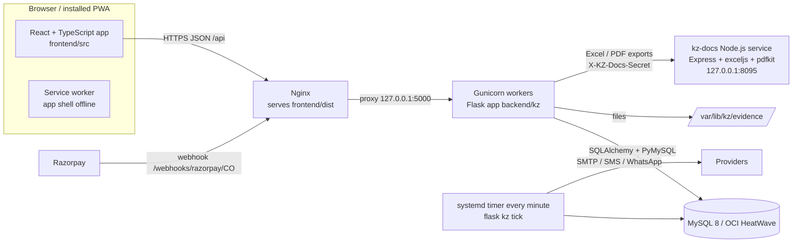

# Developer guide — Kiswa-Zaibus Operations 2.2

Read this first. It explains how the code is organised, how one request flows through it, and the rules that keep the
books and stock correct. When something breaks, go to [TROUBLESHOOTING.md](TROUBLESHOOTING.md); for the database see
[DATABASE.md](DATABASE.md), for schema changes [MIGRATIONS.md](MIGRATIONS.md), for servers [DEPLOYMENT_OCI.md](DEPLOYMENT_OCI.md).

| Reference (generated from the code — run `python backend/scripts/gen_docs.py` after changes) | |
|---|---|
| [API.md](API.md) | every route, its permission and the function that serves it |
| [ERROR_CODES.md](ERROR_CODES.md) | every error code, its message and the file:line that raises it |
| [SCHEMA.md](SCHEMA.md) | every table and column |

## 1. Architecture



* **One database, two companies.** Kiswa Garments (`KG`, uniforms) and Zaibus Enterprises (`ZE`, books) keep separate books
  (every journal has `company`). A *location* (e.g. `MSA` school counter) has one *branch* per company (`KG-MSA`, `ZE-MSA`).
* **No business logic in the browser.** The frontend only displays and collects; every rule (limits, stock, GST, numbering,
  approvals) is enforced by the API, so a phone, a desktop and a direct API call all behave the same.
* **Node.js document service (release 2.3).** `docs-service/` (TypeScript, Express) renders report tables to Excel and PDF for
  `services/docs_render.py`. It listens on loopback only, checks `DOCS_SECRET`, and if it is down or not configured Flask renders
  the same file with openpyxl / reportlab — exports never depend on it. The response header `X-Rendered-By: node | python` says
  which one answered. Tests: `cd docs-service && npm test`.
* **Finance & tax (release 2.3)** lives in `services/fin_common.py` (voucher types, GSTIN / PAN checks, GST calculation, period
  locks), `fin_vouchers.py` (build → validate → route → submit → post / reverse; approval kind `finv`), `fin_gst.py`, `fin_tds.py`,
  `fin_reports.py` (73 reports, each `{title, columns, rows, drill, totals}`), `fin_ops.py` (bank, cheques, assets, compliance,
  periods, scheduler hook) and `api/finance.py` (`/api/fin/*`, screen key `fin`). Reference data comes from
  `services/fin_bootstrap.py`, which migration 0005 and `flask kz seed` both run (idempotent).
* **Stock-audit approval (release 2.3):** review sends the variance items to the CFO / Director as approval kind `saudit`;
  `stock_audit.decide()` writes the item decisions into the approval payload and calls the approval engine, whose handler posts the
  approved items (`_post_lines`: stock moves, one adjustment, one journal with the ledgers in `settings.stock_audit.gl`) and
  records a `stock_audit_decisions` row. Generic approve / reject / return on the Approvals page go through the same handlers.
* **One request = one database transaction.** `kz/db.py` opens a session per request (`g.db`); it commits when the response
  status is below 400 and rolls back otherwise. A business error therefore leaves nothing half-done.

## 2. Folder map

```
backend/
  wsgi.py, gunicorn.conf.py      entry points (gunicorn -c gunicorn.conf.py wsgi:app)
  alembic.ini, migrations/        schema history (0001 initial, 0002 audit guards, 0003 release 2.1, 0004 stock audit)
  kz/__init__.py                  create_app(): blueprints, JSON-only rule, error handlers, logging (LOG_DIR/api.log)
  kz/config.py                    every setting, read from backend/.env (see .env.example)
  kz/db.py                        engine, per-request session, text-SQL helpers q/one/val/run/insert/add/clean
  kz/errors.py                    ApiError and bad (400) / denied (403) / not_found (404) / conflict (409)
  kz/models/                      SQLAlchemy models = the schema (one file per area)
  kz/core/                        cross-cutting: rbac (permissions), approvals (maker-checker), audit (hash chain),
                                  security (passwords, OTP, policy), numbering (bill numbers), notify (alerts, outbox), routing
  kz/services/                    business rules: sales, stock, ledger, accounts, purchasing, inventory, cash, msea, online,
                                  razorpay, paylinks, schemes, report_schedules, erp, outbox, scheduler, doctor,
                                  stock_audit (workflow), stock_audit_reports (dashboard, 10 reports, Excel / PDF)
  kz/api/                         HTTP layer only: parse, check permission, call a service, return JSON
  kz/cli/                         flask kz seed | tick | send-outbox | doctor | set-password
  seed/seed_data.json             go-live master data (companies, locations, roles, users, items, opening stock)
  scripts/gen_docs.py             regenerates docs/API.md, ERROR_CODES.md, SCHEMA.md
  tests/                          pytest: every business flow + invariants (books balance, stock = ledger)
frontend/
  src/api.ts                      fetch wrapper: ApiError, re-auth on 428, sign-out on 401
  src/auth.tsx                    who is signed in, permissions (can), working location
  src/ui/kit.tsx                  shared components: Page, Panel, DataTable (cards on phones), Modal (bottom sheet), pickers
  src/ui/forms.tsx                declarative RecordForm + custom fields block
  src/Shell.tsx                   desktop side rail / phone bottom bar + "More" sheet, install + update banners
  src/pages/*.tsx                 one file per screen; src/shop/Shop.tsx = parent store; pages/PayPublic.tsx = /pay/<id>
  vite.config.ts                  build + PWA (manifest, service worker, API never cached)
deploy/oci/                       install.sh, update.sh, backup.sh, healthcheck.sh, nginx/, systemd/, mysql-setup.sql
docs/                             this documentation
```

## 3. Life of a request (example: posting a counter bill)

1. `POST /api/pos/invoices` reaches Nginx → Gunicorn → `kz/api/pos.py:create_invoice`.
2. `@require('add', 'pos')` (kz/core/rbac.py) loads the session cookie, the user and the union of their roles' permissions.
   No permission → 403 `forbidden` and a *security event* row.
3. The API calls `services/sales.post_invoice(body)`, which in order:
   checks location scope and the books lock date → finds the student / voucher → prices the cart (`quote`: GST-inclusive
   price, discount schemes, package discounts) → validates payments (sum = total, references for UPI/card, cash limit) →
   checks discount limit and stock; if either needs a supervisor it **holds** the bill and creates an approval (202) →
   otherwise creates the invoice, posts the journal through `services/ledger.post`, moves stock through
   `services/stock.move`, updates the MSEA voucher and writes the audit entry.
4. Response 201 → `g.response_ok` → `db.finish(True)` commits everything at once. Any exception → rollback.

## 4. The rules you must not break

| Rule | Where it lives | Why |
|---|---|---|
| Money changes only through `ledger.post()`; every voucher must balance (Σ debit = Σ credit) | services/ledger.py | trial balance, GST and P&L read journals only |
| Posted vouchers are never edited or deleted; correct with `ledger.reverse()` | services/ledger.py, accounts.reverse | audit trail and GST filings |
| Stock changes only through `stock.move()` (also posts inventory value) | services/stock.py | `stock_balance` must equal the sum of `stock_ledger` |
| Never post on or before `companies.books_locked_to` (`check_lock`) | services/common.py | closed months stay closed |
| Above a role's limit, create an approval instead of acting | core/approvals.py `role_for_limit` / `request` | maker-checker |
| Every change writes `audit.write(...)`; the audit table is append-only (DB triggers) and hash-chained | core/audit.py, migration 0002 | tamper evidence (`/api/audit/verify`) |
| Numbers come from `next_no(company, series)` inside the same transaction | core/numbering.py | gap-free, per financial year |
| Raise `bad / conflict / denied / not_found` with a stable error **code** | kz/errors.py | the screen shows the message; support finds the code in ERROR_CODES.md |

The test suite checks the first two invariants after **every** test (`tests/*` fixtures `invariants`). `flask kz doctor`
checks them on a live database.

## 5. Permissions and approvals

* Screens (keys): `dash pos msea onl inv pur cash acc rep appr audit set ctl ctl.int ctl.pay saudit`.
  Actions: `view add edit submit approve reject return cancel reverse delete restore print pdf export import upload audit fin cost master cfgrep users verify review post`.
  Stock audits use `add` (create), `edit` (count), `submit`, `verify` (location in-charge), `review` (accounts / inventory),
  `approve`, `post` (adjustment), `restore` (reopen), `cost`/`fin` (see values), `export`/`pdf`; defaults in `services/stock_audit.PERMS`.
  Stored in `permissions(role, screen_key, action)`; edited in **Setup → Roles & permissions** (approval required when
  maker-checker `access` is on). A dotted key (`ctl.pay`) falls back to its module (`ctl`).
* Location scope: `user_branches` / `all_branches`; every list query uses `scope_sql()`.
* Approval limits: `approval_limits(role, limit_key, amount)`; keys `disc po pay refund adj exp cash credit transfer jv dn recon`.
  `role_for_limit(user, key, amount)` returns `None` (within the user's limit) or the role that must approve
  (ladder Store In-Charge → Branch Manager → Accounts Manager → CFO → Director, overridable by `routing_rules`).
* An approval stores the full payload; when approved, the handler registered with `@handler('kind[:sub]')` runs inside the
  approver's transaction (e.g. `@handler('exp')` posts the expense). `@on_reject` handlers undo holds.
* Evidence before approval: kinds listed in settings `controls.evBeforeApprove` (default `exp, pay, adj`) need an attached
  file first (`blocked_reason` on `/api/approvals/<id>`).

## 6. Adding a feature (checklist)

1. **Model**: add columns / a class in `kz/models/<area>.py` (import it in `kz/models/__init__.py`).
2. **Migration**: `alembic revision --autogenerate -m "..."`, review, `alembic upgrade head` (see MIGRATIONS.md).
3. **Service**: the rule in `kz/services/<area>.py` — validate, check scope/lock/limits, post through ledger/stock, `audit.write`.
4. **API**: a thin route in `kz/api/<area>.py` with `@require(action, screen)`; new module → add to `kz/api/__init__.py`.
5. **Test**: a flow in `backend/tests/` (the invariants fixture checks books and stock for you).
6. **Screen**: `frontend/src/pages/<Name>.tsx` using `ui/kit` components; route in `App.tsx`; menu entry in `Shell.tsx` (`NAV`).
7. **Docs**: `python backend/scripts/gen_docs.py`; update USER_WORKFLOW.md if users see something new.
8. Checks: `ruff check .`, `python -m pytest -q`, `npx tsc -b`, `npm run build`.

## 7. Frontend conventions (desktop + phone + PWA)

* Every list uses `DataTable`: a normal table on desktop, stacked cards under 720 px (each cell shows its column label; mark
  the main column `primary`, hide minor ones on phones with `hideSmall`).
* Dialogs use `Modal`: centred on desktop, a bottom sheet under 600 px. Destructive actions use `ConfirmBtn` (tap twice).
* Actions call `useAction()`: shows "Working…", a toast with the result, and the approval number when the API answers 202.
* Layout breakpoints (styles.css): > 860 px side rail; ≤ 860 px top bar + bottom tab bar (+ "More" sheet); ≤ 720 px cards; ≤ 600 px sheets.
* PWA: `vite-plugin-pwa` precaches the app shell; `/api/*` is **never** cached (NetworkOnly). A new build shows
  "A new version is ready" (Shell.tsx). The service worker and `index.html` are served with `Cache-Control: no-cache` (Nginx).
* Printing: invoices and labels use `.print-area`; everything else is hidden in print. Bill width (80 mm / 58 mm / A4) comes
  from Setup → Receipt & printer.

## 8. Local development

```bash
cd backend && python3.12 -m venv .venv && . .venv/bin/activate && pip install -r requirements.txt ruff==0.7.4
cp .env.example .env     # DB_*, SECRET_KEY, KZ_ENV=development, COOKIE_SECURE=0, OTP_DEMO=1 (codes shown on screen)
alembic upgrade head && flask --app wsgi kz seed --demo-students --temp-password 'Temp#2026x'
flask --app wsgi run --debug                      # API :5000
cd ../frontend && npm ci && npm run dev           # app :5173 (proxies /api and /webhooks to :5000)
```
Tests create and migrate their own database `<DB_NAME>_test` (needs a MySQL account that can create databases, or set
`MIGRATE_DB_USER/PASSWORD`). Run `python -m pytest -q` from `backend/`.

## 9. Background jobs (`flask kz tick`, every minute)

Applies scheduled access changes, expires users past `valid_to`, escalates approvals waiting longer than `escalation.hours`,
ends idle sessions, releases unpaid online orders (stock reservation), expires payment links, reminds stock-audit counters and
flags overdue audits (once a day each), runs due recurring journals, posts last month's depreciation, raises compliance
alerts once a day (`fin_ops.auto_run`), sends scheduled report
e-mails, and sends the outbox (SMTP / SMS / WhatsApp with retries 2-4-8-16 min, then `Failed`). Each step is idempotent;
running it twice does no harm.

## 10. Coding style

Python: ruff (`pyproject.toml`: pyflakes + bugbear, 200 columns), f-strings, no bare `except`. SQL in text form uses named parameters only
(`:name`) — never string-format user input. TypeScript: strict mode; `any` only for API payloads. Messages to users are
full sentences that say what to do next.
