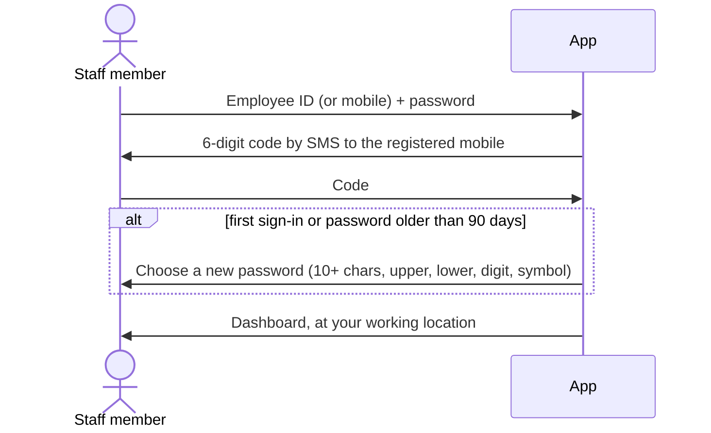
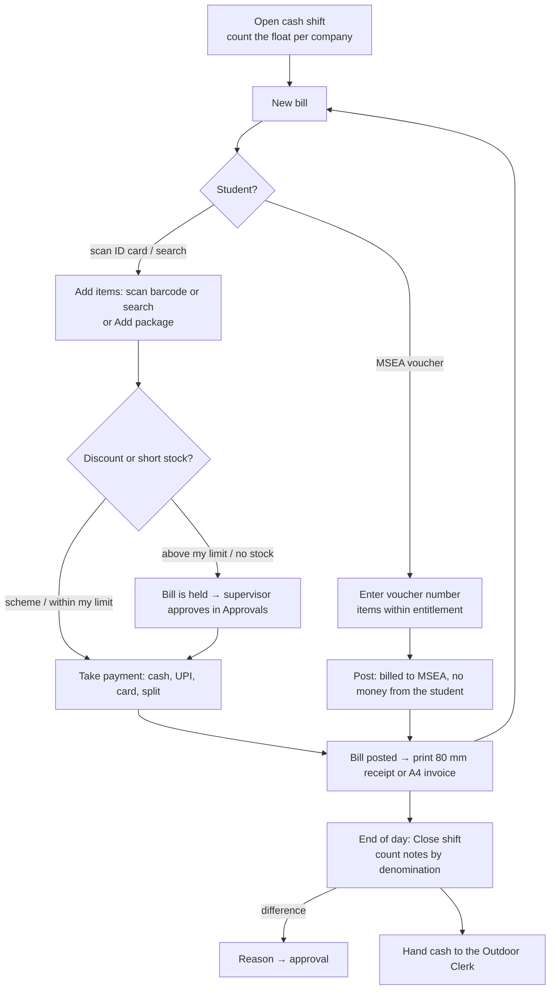
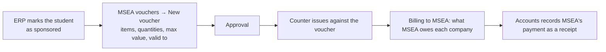
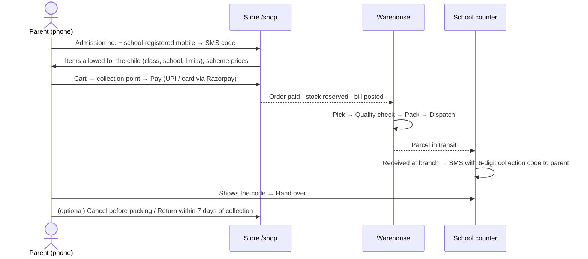
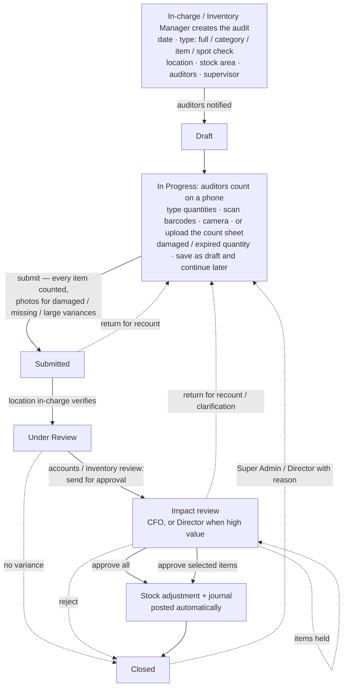
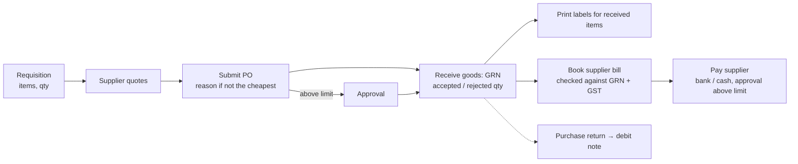
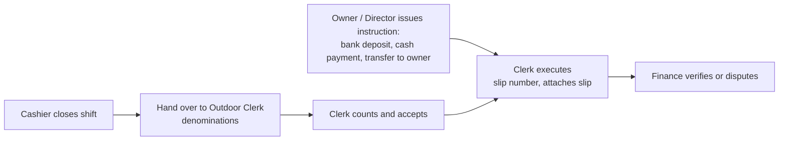
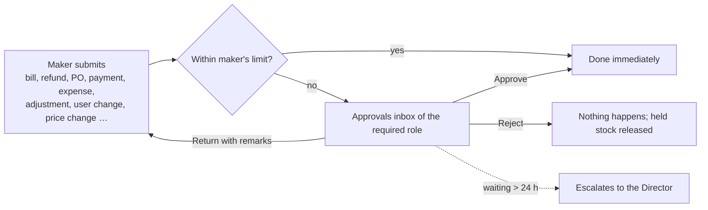

# How the application works — for the people who use it

Kiswa-Zaibus Operations runs the counters, stores, warehouse and head office of **Kiswa Garments** (school uniforms, shoes)
and **Zaibus Enterprises** (books). It opens in any browser and can be **installed on an Android phone** like an app
(Chrome → menu → *Install app*). On a computer the menu is on the left; on a phone the main screens are on the bottom bar and
everything else is under **More**. You only see the screens your role allows.

## 0. Getting around (2.5)

* **Dashboard → Your work** lists what is waiting for you, with a link to each. If it says *All clear*, nothing needs you.
* **Quick search**: click the search box at the top or press <kbd>Ctrl</kbd>+<kbd>K</kbd> (or <kbd>/</kbd>). Type a screen name, an
  action (“transfer”, “return”), a bill number, a student's name or admission number, or an item name or code; press Enter.
* Press <kbd>?</kbd> for the list of keyboard shortcuts. On *New bill*: <kbd>F2</kbd> student · <kbd>F3</kbd> item ·
  <kbd>F8</kbd> cash received · <kbd>F9</kbd> save the bill.
* The address bar remembers the tab and filters, so the browser's Back button and a refresh keep your place, and you can send a
  colleague the link to the same view.

## 1. Signing in

* 5 wrong passwords lock the account (IT or the Director unlocks it). After 3 a security question appears.
* Some actions (changing users, roles, closing a location) ask for your password again.
* If you work at more than one place, choose the **working location** at the top of the screen.

## 2. A day at the school counter (Store Cashier)

* **Deliver later**: tick it for an item that is not at the counter; give the reason. Later open the bill → *Deliver pending*.
* **Discount schemes** set by head office apply by themselves (shown in green on the line).
* **Returns / exchanges / cancellation**: Bills → open the bill → *Return / cancel* → quantities, reason, refund mode.
  Above your refund limit it goes to the In-Charge first.
* Cash above ₹1,99,999 in one bill is refused by law — take the rest by UPI / card.

## 3. MSEA sponsored students (MSEA Coordinator / Cashier)

## 4. Online orders by parents (parent store `/shop`)

Staff: **Online orders** has one tab per step (To pick, Picking, Quality check, To dispatch, In transit, Ready). Each role
sees the button for its own step. Requests (cancel / return) are approved by the Store In-Charge or managers; the refund goes
back to the original payment from the *Refunds* tab (Accounts).

## 5. Stock (Inventory Manager, Store In-Charge, Warehouse)

* **Stock**: on hand, reserved for online orders and free to sell, per location; tap a row for its movement history.
* **Items**: add or edit items, extra details (custom fields), **Price change** (approval), **Print labels**.
* **Barcode labels**: choose items (or a received PO) and how many labels → print on 50×25 mm rolls or A4 label sheets.
* **Transfers**: request → approval if above limit → the sending location *Dispatches* → the receiving location *Confirms
  receipt* (enter damaged / short quantities).
* **Adjustments**: damage, write-off, loss, found excess or physical count → attach a photo / count sheet → approval.

## 5a. Stock audits (In-Charge, auditors, Accounts / Inventory, management)

Compare what the system says is in stock with what is physically on the shelf, at any warehouse, branch, store or godown.

* **Counting never changes stock.** Each line keeps the system quantity at the moment it was counted, so sales during the count
  do not create false shortages. Variance = physical − system: **shortage in red, excess in green**, matched in normal colour.
* On the phone: *Stock audits → open the audit → Start count*. Scan a barcode with a scanner or the **Camera** button (each scan
  adds the quantity shown); items found on the shelf that are not on the list are added automatically. Or type quantities and
  *Save counts*. *Count sheet* downloads an Excel sheet to fill offline; *Upload count sheet* reads it back.
* Mark each line's condition (Good, Damaged, Expired, Missing, Excess, Returned), batch / serial and remarks; **+ Photo** attaches
  evidence. Photos are required for damaged, expired or missing items and for variances of ₹2,000 or more (Settings → Stock audits).
* Auditors cannot verify, review or approve their own audit. After submission the counts are locked. Submitted, approved and
  closed audits can never be deleted; only drafts can be cancelled.
* **Who approves (release 2.3).** After review, only the **CFO** (or the **Director** when the variance is high or above the CFO's
  limit, Settings → Stock audits) decides. Accounts / Inventory review but cannot approve; auditors never approve their own audit.
* **Impact review** (*Stock audits → audit → Impact review & decision*, or from *Approvals*): item, location, unit cost, system and
  physical quantity and value, shortage / excess / damaged quantity and value, net impact, remarks and evidence, colour-coded, with
  high-value items flagged; totals by category and condition; the accounting entry that will post; comments and history.
* **Decisions:** *Approve all & post*, *Approve selected* (each item Approved, Pending — held for a later decision, Recount or
  Rejected), *Return for recount* (remarks required) or *Reject* (remarks required). Only approved items change stock.
* **Automatic posting.** On approval the system creates the stock adjustment (e.g. `KG/ADJ/2627/0006`, linked to the audit), moves
  stock item by item, writes damaged / expired quantities off, and posts one journal with the configured ledgers: shortage
  Dr 5600 / Cr 1300, damage Dr 5610 / Cr 1300, excess Dr 1300 / Cr 4130 (change them in Settings → Stock audits). If stock was sold
  after the count and would go negative, the approval stops and asks for a recount of that item.
* **Permanent record:** every decision (who, role, when, remarks, approved / rejected / recount / held items, adjustment and journal
  numbers, before and after quantities) is kept on the audit and in the audit trail; decided items can no longer be changed.
* The **Next** bar on the audit says whose step it is and why the count boxes may not be shown. The internal **Auditor** role can
  count and attach photos on audits it is named on; *+ Auditor* adds a counter while the audit is open.
* Audits approved before release 2.3 are still posted with *Post stock adjustment (approved before 2.3)*.
* Dashboard: system vs physical stock value, shortage, excess, damaged value, audits pending approval, stock accuracy and the
  location-wise variance trend. Ten reports (summary by date and location, current vs physical, item-wise variance,
  location-wise shortage and excess, damaged / expired, pending audits, approved adjustments, high-value alerts,
  auditor-wise completion, accuracy %) — each exports to Excel or CSV; every audit exports to **PDF** and **Excel**.
* Alerts: new audit assigned, count pending, submitted for review, high variance, pending approval, adjustment posted, overdue.

## 6. Buying (Purchase Officer → approver → stores → accounts)

## 7. Cash custody (Cashier → Outdoor Clerk → Owner → Finance)

Every rupee is always with a named person or in the bank: **Cash → Clerk balances** shows what each clerk holds.

## 8. Accounts (Accountant, Accounts Manager, CFO)

* **Accounts**: every voucher, searchable; *Reverse voucher* corrects mistakes (no editing).
* New: **Receipt** (customer pays dues), **Expense** (attach the bill; approval above limit), **Contra** (cash deposited,
  withdrawn, UPI/card settlement), **Journal**, **Inter-company** (Kiswa ↔ Zaibus, CFO approves).
* **Payment links & QR**: create a link for a student's dues, one bill or an advance → share on WhatsApp / SMS or show the QR
  at the counter → the parent pays by UPI / card → the receipt posts automatically.
* **Reports**: see section 8b. **Scheduled e-mails** (daily / weekly / monthly, CSV attached) are on the Reports page.
* **Settings → Books lock date**: once a month is closed and reviewed, lock it (Director approves); nothing can be posted
  into a locked period.

## 8a. Finance & tax (Accounts Executive, Branch Accountant, Finance Manager, CFO, Director, Auditor)

*Finance & tax* in the menu, one company at a time (choose it top right). Eleven tabs:

| Tab | What you do there |
|---|---|
| Dashboard | Income, expenses, profit, cash and bank, receivables, payables, GST and TDS due, vouchers waiting, alerts, monthly trend |
| Vouchers | 21 types: receipt, payment, contra, journal, sales / purchase invoice, credit / debit note, expense, salary, stock adjustment, GST adjustment, TDS deduction / payment, bank reconciliation, asset capitalisation, depreciation, provision, reversal, inter-branch, inter-company |
| GST | Set-off under rule 88A, GST payment (challan), GSTR-1 and GSTR-3B with portal JSON, filing ARNs, e-invoice IRN and e-way bills, GSTR-2B / 2A reconciliation |
| TDS | Deductions, challan (Form 141) with interest, quarterly returns Form 138 / 140 / 144 / 143, certificates Form 130 / 131, PAN and threshold checks |
| Reports | 73 reports (Financial, GST, TDS, Assets, Bank) with drill-down from the trial balance to the ledger to the voucher; Excel, PDF and CSV |
| Bank | Import the bank statement (Excel / CSV), automatic and manual matching, bank charges / interest posted from the statement, BRS, cheques (cleared, dishonoured, stop payment) |
| Payables & receivables | Payment proposal by priority and due date with the bank balance; one payment voucher per supplier; open receivables |
| Fixed assets | Capitalise, monthly depreciation (Companies Act, straight line), transfer, impairment, disposal with gain / loss, physical verification |
| Compliance | GST, TDS, PF / ESI / PT, advance tax, audits, ROC — due dates, status, acknowledgement numbers, documents; GST / TDS items close themselves |
| Year-end | Close a financial year: checklist, profit to capital / partners, closing entry, lock; reopen (Director) — see below |
| Setup | Close / reopen periods (CFO / Director), masters (cost centres, TDS sections, party PAN / section / lower-deduction certificate, employees, HSN / SAC, banks, asset categories, approval rules, budgets, GST registrations, recurring journals) and controls |

* **New voucher:** choose the type, date, location, party, bill number, cost centre and department; enter the ledger lines. Tick
  *GST* to add HSN / SAC lines (CGST + SGST inside Telangana, IGST across states, reverse charge, blocked credit added to cost) and
  *Deduct TDS* to choose the section (threshold, lower-deduction certificate and no-PAN rate are applied). The panel underneath
  shows the journal that will post, the balancing party line, any error and who must approve.
* **Maker → checker → approver.** Within your limit and without a rule, *Post* posts at once. Otherwise *Submit* sends it to the
  role the rules name (e.g. any voucher above ₹5 lakh → CFO, above ₹20 lakh → Director, any journal touching capital → Director;
  purchase invoices, GST adjustments, reversals, inter-company and asset capitalisation always need a checker). The maker cannot
  approve their own voucher. Expense, purchase and GST vouchers need the bill attached before approval.
* **Never edit a posted voucher:** *Reverse* raises a reversal voucher for approval. Duplicate supplier bills are refused; a
  near-duplicate (same supplier and amount within 7 days) needs *Not a duplicate*. A purchase invoice against a PO is matched to
  the PO and goods receipt (3-way, 2 % tolerance).
* **Closed periods:** entries dated on or before the books-closed date, in a month whose GSTR-3B is filed, or in a closed year go to
  the CFO / Director for approval.
* **GST each month:** *GST → Set-off & payment* shows liability, credit used head by head and cash to pay with interest and late
  fee; *Pay GST* creates the GST adjustment voucher (attach the challan); record GSTR-1 and GSTR-3B ARNs after filing on the portal.
* **TDS each month / quarter:** tick the deductions and *Pay challan* (BSR code and serial); after the quarter, record the return
  token, then issue Form 130 / 131 certificates. Government portals (GSTN, IRP, TRACES, banks) are not connected in this version.

## 8b. Reports (everyone with Reports → view)

*Reports* lists the reports your role may open, grouped as Sales, Stock, Purchasing, Cash, MSEA & online, Controls and
Financial (48 in all; see the README for the full list).

1. Choose a report on the left.
2. Set the filters: company, from / to (or *as of* for balances), location, and the report's own filter where it has one
   (item code, category, status, days without a sale, account, search text).
3. Click a row with a pointer to open its detail: a day opens that day's bills, a category opens its items, an item opens its stock
   ledger, a bill opens the bill. The breadcrumb above the table goes back.
4. **Print** prints only the report (title, company, period, your name and the time, every page with the column header; wide
   reports in landscape). **PDF**, **Excel** and **CSV** download the same table with the same totals.

What you see depends on your rights: buttons appear only for *print / pdf / export*; cost, margin and value columns need *cost*;
financial statements need *financial figures*; rows are limited to your companies and locations. Every print and download is
recorded in the access log.

The same Print / PDF / Excel / CSV buttons are on **Finance & tax → Reports** (73 reports) and **Stock audits → Reports**
(10 reports).

| Question | Report |
|---|---|
| How much did each counter sell and collect today, by cash / UPI / card? | Daily sales and collection; Cashier-wise sales; Payment-mode collection |
| Which cashier was short at closing? | Cashier shift closing (short / excess) |
| What must we reorder? | Low stock / reorder (suggested order); Pending purchase orders |
| What is not selling? | Slow and non-moving stock; Stock ageing |
| Where did this item's stock go? | Stock movement → click the item → Item stock ledger |
| Did we pay more than the lowest quote? | Supplier price comparison |
| How fast are approvals decided? | Approvals register (turnaround hours) |

### Closing the financial year (CFO / Director, after 31 March)

1. Open *Finance & tax → Year-end* and choose the year (the oldest year that has ended is chosen for you).
2. **Before closing**: fix every ✕ (post or cancel draft and pending vouchers; close earlier years first). Review every !
   (unfiled GST or TDS returns, depreciation not run, unreconciled bank lines, open stock audits, overdrawn cash) — click *Open*
   to go to the screen. Items you accept stay on record with the closing.
3. **Profit to transfer**: check income, expenses and profit; choose where it goes — *3000 Capital Account* for a proprietor, or
   each partner's capital account with the profit-sharing percentages (they must add up to 100%). Add accounts under the chart of
   accounts (code starting 3) if needed.
4. Print the year-end pack (trial balance, P&L, balance sheet, cash flow) from the links at the top.
5. **Close**: tick that you reviewed the ! items, give the reason (e.g. "Accounts finalised; audited by M/s … on 15-09-2026"),
   *Close FY*, confirm and re-enter your password. The year is locked; nobody can post into it.
6. **Correction after closing** (e.g. the auditor's adjustment): the Director opens the year, enters the reason and *Reopen FY*.
   Post the correction, then close the year again (the closing entry is worked out afresh).

## 9. Approvals (In-Charge, Branch Manager, Accounts Manager, CFO, Director)

The approver sees the full details, the evidence files and the history. A maker never approves their own request.

## 10. Administration (Super Admin, Director, IT)

* **Users & access**: new user (role, companies, locations, valid dates) → approval → temporary password by SMS. Unlock,
  end sessions, and **schedule a resignation, transfer or suspension** for a future date (applied automatically that day).
* **Setup**: companies, locations (open / close), zones, counters, receipt & printer, schools, item categories, packages,
  **discount schemes**, suppliers, customers, students' extra details, chart of accounts, **roles & permissions** (with
  approval limits), custom fields.
* **Settings**: security policy, business controls, maker-checker switches, escalation, online store rules, alert rules,
  ERP student import, Razorpay status and reconciliation.
* **Audit trail**: who did what, when, from which device, old and new values; *Verify integrity* proves nothing was altered.

## 11. Roles at a glance

| Role | Main screens |
|---|---|
| Store Cashier | New bill, Bills & returns, own cash shift |
| Store In-Charge / Branch Manager | + approvals within limits, stock, transfers, adjustments, stock audits (create, verify), online requests, cash handovers |
| Branch Collection Staff | Online orders: receive at branch, hand over with code |
| Warehouse Picker / QC / Packer / Dispatcher | Online orders: their own step |
| Inventory / Warehouse Manager | Stock, items, labels, transfers, adjustments, stock audits (create, review, post), all online steps |
| Purchase Officer | Purchasing, suppliers |
| Accountant / Accounts Manager / CFO | Accounts, payment links, reports, supplier bills and payments, approvals (by limit) |
| MSEA Coordinator / Cashier / Outdoor Clerk | MSEA vouchers; clerk: cash custody |
| Director / Owner / Chairman | everything, final approvals, owner instructions |
| Auditor | read-only: reports, audit trail, vouchers |
| Super Admin | every right on every screen, the highest limits, all reports; cannot approve own requests (2.7) |
